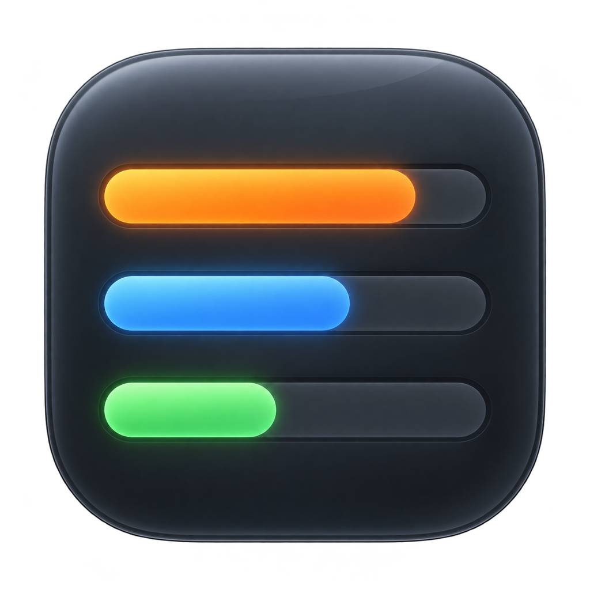
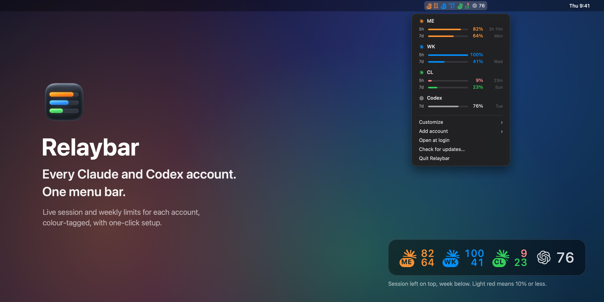
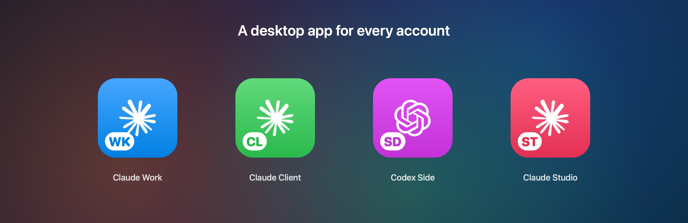
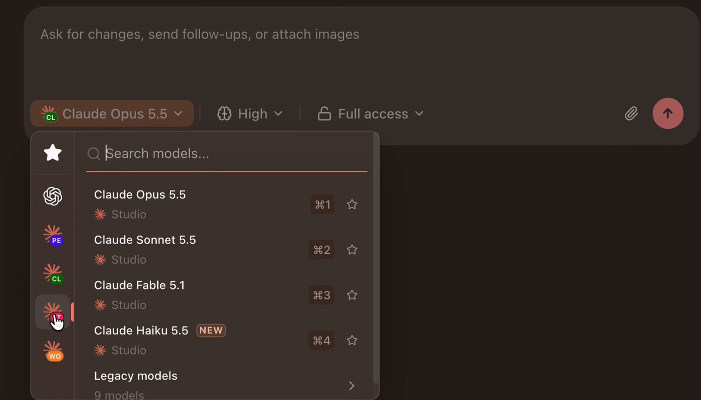

<div align="center">



# Relaybar

**Every Claude and Codex account. One menu bar.**

See how much of each Claude and Codex limit is left, live, for every account on your Mac.

[](https://github.com/sgaabdu4/relaybar/releases/latest)

[](LICENSE)

**[Download the latest release](https://github.com/sgaabdu4/relaybar/releases/latest)**



</div>

## Watch it work

Add a Claude account, sign in, open its own desktop app and use it in T3 Code. All names are sample accounts.

https://github.com/user-attachments/assets/65b1f635-a769-4021-8cd1-288c8367ca0d

## Why Relaybar

- **Know which account has room.** The 5-hour session and weekly limit of every account, at a glance.
- **Tell accounts apart instantly.** Each one gets its own colour and a short tag, such as WK or CL.
- **Add an account in one click.** Sign in through your browser. Relaybar sets up the rest.
- **Tiny and native.** About 15 MB of memory and almost no CPU. Pure Swift and AppKit.

## Read it at a glance

| You see | It means |
| --- | --- |
| Top number | Session (5-hour) limit left, in % |
| Bottom number | Weekly limit left, in % |
| Light red number | 10% or less left |
| `…` | Waiting for the first numbers |
| **Login expired** in the menu | Use that account once in Claude or Codex to renew it |

Click an account in the menu to open its desktop app.

## Add an account

1. Click Relaybar, then **Add account**, then **Claude** or **Codex**.
2. Type a name (for example *Work*), a short tag (*WK*) and pick a colour.
3. Your browser opens the sign-in page. Sign in.

The account appears in the menu bar a few seconds later. Relaybar also:

- creates its own folder (`~/.claude-work` or `~/.codex-work`), so it never mixes with your other accounts;
- makes a desktop app, such as **Claude Work**, with your tag and colour on the icon (you can turn this off);
- adds the account to [T3 Code](https://t3.codes), if T3 Code is installed.



In T3 Code, every account shows up in the model picker with its own tag, ready to choose per chat.



## Remove an account

Click Relaybar, then **Customize**, the account, then **Remove**. You can hide it, or delete it from your Mac: its folder, desktop app, saved login and T3 Code entry. Deleting asks three times, and files go to the Trash. Your main `~/.claude` and `~/.codex` folders can only be hidden.

## Combine accounts

Optional. T3 Code uses whichever of your accounts has room. When one runs out, the next one takes over, so you stop switching by hand.

> **Combining accounts can get your accounts banned.** Anthropic or OpenAI may treat it as against their terms. Relaybar cannot stop or undo a ban. Two rules:
> 1. Use your plans only for your own work. Never use them to serve other people.
> 2. Use Claude plans only for Claude models in Claude Code. Never use them in any other app.
>
> Run the helper only on your own computers at home. Never on a cloud server or behind a VPN.

1. Click Relaybar, then **Combine accounts…**.
2. Check **Runs on**. Relaybar fills in the best computer: a Linux computer at home that is always on, or this Mac.
3. Tick the box to accept the risk, then click **Combine**.
4. Click **Sign In** on each account and sign in to that account in the browser. Relaybar checks it is the right account. **Done** works once one account is signed in. Accounts left out show in **All accounts** with "Not signed in".

New chats in T3 Code now use **Claude, all accounts**. **Codex, all accounts** is there too. Your single-account entries stay. In a terminal, use `claude-all` and `codex-all`.

How it works:

- **The helper:** [CLIProxyAPI](https://github.com/router-for-me/CLIProxyAPI) picks the account. Relaybar installs it, checks the download, and locks it in: it cannot read your home folder or Keychain, or start other programs. It listens only on the computer that runs it.
- **Your logins:** you sign each account in to the helper again. The helper keeps those new logins on the computer that runs it and renews them. Your normal logins stay as they are.
- **Where it runs:** this Mac, or a Linux computer at home. Other computers reach it with SSH, by its home network address, its Tailscale address or its SSH name. If SSH asks for a password, **Set Up SSH for Me** makes a key and opens Terminal so you type that computer's password once.
- **Away from home:** this needs [Tailscale](https://tailscale.com). If both computers already have it, Relaybar uses it by itself. If not, **Set Up Tailscale…** does the steps. You type your Mac password, click Allow once and sign in once.
- **Order:** new chats use your first account until it has less than 10% left, then the next one. Open chats stay on their account, so their prompt cache is not rewritten. Change it in **All accounts**, then **Change order…**.
- **Pause:** in **All accounts**, untick an account to pause it. Tick it to use it again.
- **Other Macs:** Relaybar finds a home computer that already runs the helper and offers **Use combined accounts**.
- **Linux computers:** in **All accounts**, click **Add a computer…** and pick one. Relaybar gives it its own SSH key that the home computer accepts only for the helper, and adds `claude-all`, `codex-all` and, if T3 Code is there, its two entries. Remove it from **Computers** in **All accounts**; it asks twice.
- **Updates:** each night, the computer that runs the helper installs a new helper version by itself. It waits until a version is 3 days old, checks the download, tests it, and goes back to the old version if the test fails. Relaybar keeps a [block list](pool/blocked-versions.txt) of bad versions.
- **Stop:** **All accounts**, then **Stop combining…**. It asks twice, then removes everything it added.

If a bad helper version is ever reported, click **Stop combining…**, then sign out of all sessions on claude.ai and chatgpt.com. That makes the helper's logins useless.

Stuck, or want to do it by hand? Give your coding agent the [agent guide](docs/combine-accounts-agent.md).

## How live is it?

- **Codex:** updates the moment you send a message, from Codex's own session logs.
- **Claude:** checks when that account is in use (at most once a minute) and every five minutes otherwise.
- **Logins:** Relaybar only reads them and never renews them, because renewing would sign the account out of Claude Code. When you combine accounts, you sign each account in to CLIProxyAPI again. CLIProxyAPI keeps those new logins on the computer that runs it and renews them. Relaybar itself still never copies or renews a login.

## Updates

Relaybar updates itself. It checks for a new version every hour and installs it the next time it starts. **Check for updates…** in the menu checks now.

## Privacy

- No analytics and no server of its own. Relaybar asks Anthropic and OpenAI for your usage with your own logins.
- Logins stay in your Keychain and in Claude's and Codex's own files. Relaybar never copies them.
- When you combine accounts, Relaybar asks ipinfo.io for each computer's public address to check it is at home. Each night, the computer that runs the helper asks GitHub for new helper versions and Relaybar's block list. The helper itself also checks some tool versions online when it starts.
- Desktop apps are clones of the official Claude and Codex apps on your disk. A clone takes almost no extra space.

## Requirements

- macOS 14 or later, on Apple silicon or Intel.
- [Claude Code](https://claude.com/claude-code) or the [Codex CLI](https://github.com/openai/codex), to sign in new accounts.
- The Claude or Codex desktop app, for per-account desktop apps.

## Build from source

```bash
git clone https://github.com/sgaabdu4/relaybar.git
cd relaybar
./build.sh --install
```

`scripts/test.sh` runs the tests. `scripts/efficiency.sh` launches the built app and fails if it uses more than 30 MB of memory or more than 1% CPU while idle. Every merge to `main` that changes the app publishes the next version (1.0.1, 1.0.2 and so on), signed and notarised.

## Credits

- Claude and Codex logos from [OpenUsage](https://github.com/robinebers/openusage) by Robin Ebers, MIT licence (`Resources/LOGOS-LICENSE.txt`).
- Claude is a trademark of Anthropic. Codex, ChatGPT and OpenAI are trademarks of OpenAI. Relaybar is not affiliated with either company.
- Screenshots use sample accounts.

## Licence

[MIT](LICENSE)
