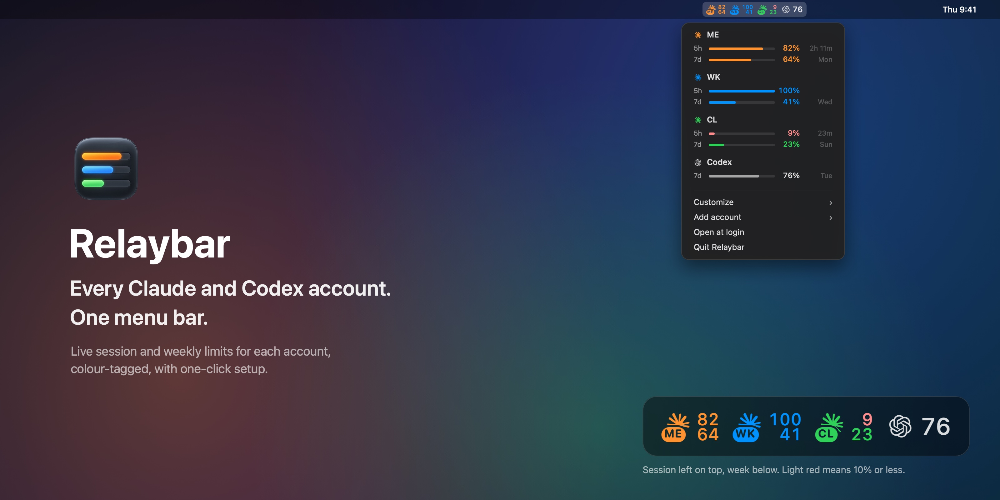
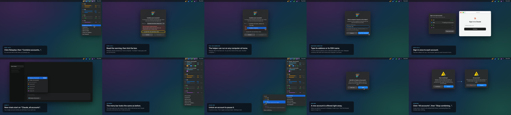
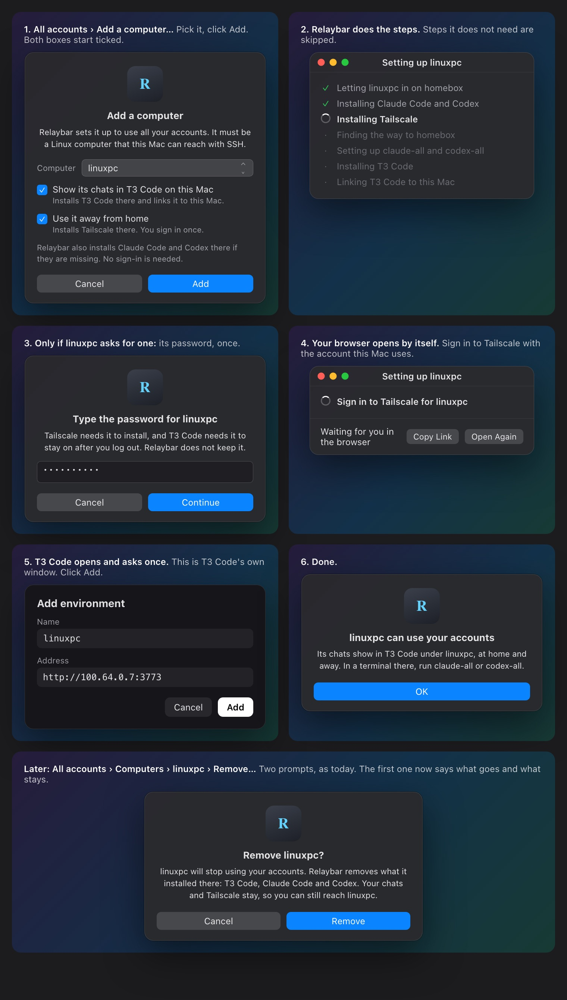

# Combine accounts

Status: Ready

## Outcome + scope

Optional "Combine accounts" beside today's per-account mode, in the public app. Relaybar runs CLIProxyAPI (the helper that picks an account with room) on this Mac or on a home Linux computer, picked in the first dialog. The user can pick a found computer or type its home network address, Tailscale address or SSH name. Every Mac reaches a home helper through its own SSH tunnel, so Tailscale is optional and the helper never listens on the network. It signs each account in to the helper once, adds "Claude, all accounts" and "Codex, all accounts" to T3 Code through new `~/.claude-hub` and `~/.codex-hub` folders, adds the helper as a T3 Code usage source, shows combined and per-account usage, lets other computers use a home helper, and stops cleanly. Not in scope: Windows or cloud-server hubs, VPN setups, changes to `~/.claude` or `~/.codex`, the proxy's web panel, Docker installs.

## Repository context

Owners: `Sources/RelaybarCore/T3Settings.swift` (T3 entries; writes only `homePath` today), `Sources/RelaybarCore/Usage.swift` (`UsageParser.claude`, `UsageParser.codex`, reused for pooled usage), `Sources/RelaybarCore/AccountScanner.swift` (lists only folders with a login, so hub folders stay out), `Sources/Relaybar/App.swift` (menu, `NSAlert` flows), `Sources/Relaybar/AccountCard.swift` + `Render.swift` (drawing), `Tests/RelaybarCoreTests`, `README.md`, `PRODUCT.md`, `DESIGN.md`. New pool logic lives in `Sources/RelaybarCore/Pool*.swift`; UI stays in `Sources/Relaybar`.
Evidence (checked 2026-10-28):
- Homebrew `cliproxyapi` 8.0.45: binary `cliproxyapi`, config `$(brew --prefix)/etc/cliproxyapi.conf`, `brew services` with keep-alive; macOS bottles for Apple silicon only (Intel builds from source).
- `cmd/server/main.go` v8.0.45 flags: `-claude-login`, `-codex-login`, `-codex-device-login`, `-no-browser`, `-config`.
- `config.example.yaml` v8 keys: `server.host`, `server.port`, `management.secret-key` (hashed on start), `management.allow-remote`, `access.api-keys`, `routing.strategy`, `routing.session-affinity`, `routing.session-affinity-ttl`, `routing.retry.request-retry`, `oauth.auth-dir`, `observability.logs.request-log`, `observability.logs.logging-to-file`, `observability.usage.usage-statistics-enabled`.
- Management API v8 ([docs](https://help.router-for.me/management/apiv8.html)): no quota endpoint; `POST /v8/management/requests/api-call` with `auth_index` and a `$TOKEN$` header calls Anthropic or OpenAI with a stored login that Relaybar never sees; `GET /v8/management/credentials` lists logins; `DELETE /v8/management/credentials?name=` signs one out.
- GitHub releases (checked 2026-10-29): files for macOS (Apple silicon and Intel) and Linux, Linux also without plugins, plus `checksums.txt`; no signatures, and the checksums sit in the same release. About one release a day (30 from 7 to 29 October); 8.0.0 came out 2026-09-27, 7.3.0 on 2026-09-13. Homebrew builds from the source tag and lags about two days. Repository: MIT, about 57,000 stars, started 2025-07-01.
- T3 Code provider entry schema: `environment: [{name, value, sensitive, valueRedacted}]`; sensitive values go to T3 Code's secret store through `mapSettingsSecrets`.
- T3 Code Nightly 0.1.4 (app bundle, 2026-10-28): Codex "Use existing CLI" is `config.setupMode: "existing"`; a Claude entry whose `ANTHROPIC_BASE_URL` is not `api.anthropic.com` skips the signed-in check; `usageLimitSources.<id> = {kind: "cliproxy", label, url, managementKey, enabled}` is the "Add a CLIProxyAPI hub" usage source, and `managementKey` is a secret field; `autoResumeLimitedThreads` and `snoozeLimitedThreads` exist and default to off.
- Codex `model_providers.<id>.auth.command` prints the bearer token, so the access key can come from the Keychain, not a file.
- A user may link `~/.claude` files into every `~/.claude-*` folder (`settings.json` included). Pool settings written into `~/.claude-hub/settings.json` would then edit `~/.claude/settings.json` for every account.
Probes before the build (2026-10-29, real binary 8.0.44 in a scratch folder, fake accounts only):
- The macOS release binary is ad-hoc linker-signed and runs as-is on Apple silicon; its checksum matched `checksums.txt`. It needs its own folder as the working directory.
- `GET /v1/models` answers 401 without the key and 200 with it; before any sign-in the list is empty. The management secret is hashed in the config file on start, so only the Keychain keeps it in plain text.
- The helper logs each request line to its output, including query strings, so its output goes to `/dev/null`. On start it also checks some tool versions online (Antigravity, Grok CLI on npm).
- `-claude-login` and `-codex-login` look up the computer's public address and listen on every network interface (54545, 1455). The management route `GET /v8/management/oauth/auth-url?provider=claude|codex` returns the sign-in link with `redirect_uri` `http://localhost:54545/callback` or `http://localhost:1455/auth/callback` and opens no port; `POST /v8/management/oauth/callback` (no management key, needs the unguessable state) takes `{provider, code, state}`; `GET /v8/management/oauth/status?state=` returns `wait`, `ok` or `error`. A fake code reached the token exchange and came back as `error`.
- Seatbelt profile (allow by default, deny reads and writes under the home folder except the helper folder, deny the Keychain services) ran the helper: TLS calls worked, `/v1/models` answered, a home file read failed, and a Keychain read failed (44) where it works unsandboxed (0).
- T3 Code Nightly source: on every settings file change it reloads and moves inline *field* secrets (`managementKey`) into its secret store, but never environment values. Its secret store is `~/.t3/userdata/secrets/<name>.bin`, raw bytes, mode 0600, folder 0700. Names: `provider-env-<base64url(instance id)>-<base64url(variable)>` and `usage-limit-source-<base64url(source id)>`. A stored environment value is written as `value: ""`, `valueRedacted: true`; a stored field as `"••••••"`.
- Claude Code in an empty config folder with only `ANTHROPIC_BASE_URL` and `ANTHROPIC_AUTH_TOKEN` reached the helper and passed its key check (400 "unknown provider" with no logins). Codex 0.165 in an empty `CODEX_HOME` with a `relaybar` provider and `auth.command` did the same.
- Linux (Ubuntu 24.04 container with systemd, over SSH): the no-plugin release passed its checksum, ran as a user service with lingering, answered `/v1/models`, and with `ProtectHome=tmpfs` plus `BindPaths` for its folder it could read and write its folder but not a home file.
- Not yet known: the Codex account id for `ChatGPT-Account-Id` (needs a real Codex sign-in; checked in the journey).
Same cause: N/A — new feature, not a fix.

## Decisions + authorization

Settled by the user, 2026-10-28:
- Ships in the public app. Tracked files, tests, images and PR text use sample names only: no personal data, host names, tailnet names, real IP addresses or project names. A generic sample such as `192.168.1.20` is allowed in hint text.
- Pool runs beside per-account mode. Separate folders `~/.claude-hub` and `~/.codex-hub`; back up any file before editing it.
- Other computers are in scope: a home Linux computer can run the helper over SSH; other machines can use it.
- Typed addresses (user, 2026-10-29): Relaybar is public, so people must be able to type a home network address or a Tailscale address in the first dialog, not only pick a found SSH name.
- After the first video was confusing, the flow became "Combine accounts". The user kept the home computer, then approved these changes after the T3 Code audit ("yes apply it"):
  - The computer is picked in the first dialog, so there is no later move step and helper logins are never copied between computers.
  - Single-account T3 entries stay as they are; "Claude, all accounts" becomes the default for new chats.
  - When T3 Code is installed, Relaybar adds the helper as a T3 Code usage source by itself, once, and removes it on stop.
  - Terminal commands are `claude-all` and `codex-all`.
- Account controls, approved from the mockup and video (user: "I'm happy with it"): one "All accounts" submenu holds every control. Tick or untick pauses or resumes an account at once with no prompt; an account not yet in the helper signs in when ticked; a signed-out account shows in red and signs in again in one click; the last account of each kind cannot be paused; adding an account to Relaybar while combined offers to add it to the helper; "Stop combining…" sits at the bottom of the submenu. To use one account only, the user picks its own T3 Code entry.
- Design audit, 2026-10-29 (user asked for easier, cleaner spacing): mockups now use the app's real sizes (250 pt cards, 14 pt inset, 22 pt header, 18 pt rows), the real logos and app icon, and native parts: `NSAlert` with the app icon on top, centred text and equal-width buttons with the default on the right; an `NSPopUpButton` for "Runs on"; `NSMenuItem` section headers and two-line items (`subtitle`, macOS 14.4, with an attributed-title fallback on 14.0 to 14.3) for account states.
- Design rules: idiot-proof (risky choices blocked, right answer filled in, every message says what happened and what to do next), least load, most automation, fewest clicks, clear order, more than one prompt for destructive actions.
- Use it before it resets (user, 2026-10-29: "yesss use before reset is such a great idea!"; replaces "Soonest-reset-first routing stays out of version 1"): the order is automatic by default. New chats go to the account whose weekly limit resets soonest, if it has at least 10% left in both its 5-hour and weekly limits; accounts whose weekly resets are within the same hour count as a tie, and the one with more weekly left goes first; then the saved order. Accounts under 10% drop below the others as before. "Change order…" keeps a "Use my order" switch for the manual order. Open chats and their subagents stay on their account (session affinity), so only new chats follow the order.
- Account order (user, 2026-10-29: "prioritise one most of the time and then to the other when close to usage limit"; mockup approved with "yes pls add"): "Change order…" in the "All accounts" submenu opens a dialog with a Claude/Codex switch and a list you drag. New chats use the top account. When it has less than 10% left in its 5-hour or weekly limit, new chats move to the next one; it returns to its place when it has 10% or more again. Open chats stay on their account. Relaybar sets each login's helper `priority` through `PATCH /v8/management/credentials/fields` (field present in the helper's source, v8.0.44); round-robin then only applies between accounts of equal priority. The account new chats use shows "in use" on its card. New logins go to the bottom.
- SSH setup (user, 2026-10-29): when SSH to a typed or found computer fails with a password or key problem, the message offers "Set Up SSH for Me": Relaybar makes an SSH key on this Mac if there is none (`ssh-keygen -t ed25519`, no passphrase prompt in the app) and opens Terminal with `ssh-copy-id <address>` filled in, so the user types that computer's password once; then Try Again.
- Agent guide (user, 2026-10-29): `docs/combine-accounts-agent.md`, a short guide a user can paste into Claude Code or Codex: set up SSH access to the home computer, check and fix the helper, use combined accounts from a terminal or a Linux computer, and the rules (never print keys, home computers only, Claude plans only in Claude Code). Relaybar does not need it; it is for people who get stuck or want to do it by hand.
- Tailscale (user, 2026-10-29: "as easy as possible and less human intervention"): needed only to use a home helper away from home; never part of the first setup. If this Mac and the home computer are already on the same Tailscale network, Relaybar switches the helper connection to the home computer's Tailscale address by itself, with no prompt. Otherwise the done screen offers "Set Up Tailscale…", one panel with a checklist: this Mac first (download Tailscale's signed installer from pkgs.tailscale.com, check its signature is Tailscale's, install it with one macOS password prompt, open Tailscale; the user allows its network extension and signs in once), then the home computer over SSH (Tailscale's official install script with `sudo`, then `tailscale up`, whose sign-in link Relaybar opens in the same browser, so it is one click). Relaybar then checks the home computer answers on its Tailscale address and switches the connection. It never uses Tailscale SSH (its default rule asks to sign in again every 12 hours, which would break the background connection), and never changes an existing Tailscale setup (exit node, routes, accounts). Sources: tailscale.com docs for Linux install, macOS install and system extension, Tailscale SSH.
- Add a computer (user, 2026-10-29: "shouldn't relaybar set up everything for me … I can connect to the relaybar on my linux, windows and mac easy"; approved "yes pls"): "All accounts › Add a computer…" replaces "Use on a Linux computer…". The user picks a computer from the same "Runs on" style list (SSH names this Mac knows, minus the hub, home filter; "Another computer…" to type one) and Relaybar does the rest over SSH from this Mac. Linux only: a Mac gets "Open Relaybar on that Mac; it connects in one click" (the existing join offer); anything else gets "not supported yet". Windows is out of scope. The other computer gets its own key that the hub accepts only for the helper port (`restrict,port-forwarding,permitopen="127.0.0.1:8317",command="/bin/false"`, tagged), a pinned hub host key read over this Mac's SSH, a tunnel to the first hub address that works from there, `claude-all` and `codex-all`, and the two T3 Code entries if T3 Code is there (never the usage source, so the management secret stays off other computers). Connected computers show under All accounts; removing one asks twice; Stop removes every one before the hub.
- Add a computer installs what it needs (user, 2026-10-29: "let's go with one", "give the option for the user to install T3 code as well", "if there is Tailscale installed we can offer to install Tailscale as well", "least clicks"): missing Claude Code and Codex are installed with no question, from each maker's official script, with no sign-in. When this Mac has T3 Code, a tick box (on) installs T3 Code there from its official script on this Mac's release channel, runs it as T3 Code's own background service, and links it to this Mac's T3 Code by opening the `t3code://pair` link from `t3 pair` there; T3 Code asks once to confirm. When this Mac or the home computer uses Tailscale, a tick box (on) installs Tailscale there with the home computer's existing steps; with Tailscale, T3 Code there listens only on its Tailscale address. That computer's password is asked once, only when `sudo` needs it, and never kept. Remove takes away only what Relaybar installed; Tailscale and chats stay.
- Your setup comes along (user, 2026-10-29: "Shoudln't we have migrate rules to the all accounts?"): on every computer Relaybar sets up (this Mac and added computers), the "all accounts" folders use the user's own setup on that computer. Relaybar links, never copies: `CLAUDE.md`, `rules`, `skills`, `agents`, `commands`, `output-styles`, `hooks`, `settings.json` and `plugins` from `~/.claude` into `~/.claude-hub`; `AGENTS.md`, `rules`, `skills`, `prompts` and `hooks.json` from `~/.codex` into `~/.codex-hub`. Only items that exist and are missing in the hub folder are linked, so links a user made stay. `codex-all`, which the Codex T3 entry also starts, rebuilds `~/.codex-hub/config.toml` from `~/.codex/config.toml` each start, with only the provider set to the combined accounts. Stop and Remove delete only the links Relaybar recorded, never the user's files.
- Exit nodes: a home computer can also be a Tailscale exit node for the user or other people. The helper listens only on that computer, so exit-node users cannot reach it. A Mac that uses that exit node shows the home address, so it passes the at-home check.
- Prompt cache (user, 2026-10-29, from the reference setup guide: "if a thread hops accounts per prompt, or worse per tool call, you eat a ton of cache writes"): each chat stays on one account. Session affinity is on for 1 hour (the longest prompt-cache lifetime, so a binding never outlives its cache). The helper keys a chat by Claude Code's and Codex's own session headers first. Subagents stay on their parent's account. `session-affinity-rebind-on: "quota"`: a short upstream error (408, 5xx, empty stream) retries that one request elsewhere but keeps the chat bound; only quota or sign-in errors move it. Bindings live in memory, so the nightly update restarts the helper only when it swaps the version. Pausing an account moves its chats once; resuming does not pull them back.
- Helper updates (user, 2026-10-29: "completely hands off"; wait chosen: 3 days): fully automatic, with no user step. One update script runs nightly on whichever computer runs the helper (launchd on a Mac, a systemd user timer on Linux). It takes the newest release that is at least 3 days old, in the major version this Relaybar supports, and not on Relaybar's block list; checks it against `checksums.txt`; swaps it in; runs the setup check; and puts the old version back if the check fails. It keeps the last good version. No early path for releases called security fixes. A new major version waits for a Relaybar update that supports it.
- The helper comes from the checked GitHub download on both Mac and Linux, not from Homebrew, so the 3-day wait and going back work, and Homebrew is not needed. This replaces the earlier "brew install and brew services" choice.
- Block list: `pool/blocked-versions.txt` in this repo, read from GitHub by the update script. It can only block versions. A blocked version that is installed is replaced by the last good one. If the list cannot be read, no update happens that night.
- The helper runs locked in: it can read and write only its own folder and use the network. macOS: a `sandbox-exec` profile (the same Seatbelt sandbox Codex uses). Linux: systemd limits (`ProtectHome`, `ProtectSystem=strict`, `ReadWritePaths` for its folder only, `NoNewPrivileges`, `PrivateTmp`).
Recommendations awaiting approval (design response to "simplify"):
- Four steps: click "Combine accounts…" in the menu, tick the risk box ("Combine" stays grey until then), click Combine, then sign in to each account in a list Relaybar fills in.
- The first dialog has one filled-in line, "Runs on", always shown. Its choices: each found home computer (for example "homebox (at home, always on)"), "This Mac", and "Another computer…". The default is the found home computer, else "This Mac". "Another computer…" asks for an address or SSH name and checks it before the dialog goes on; a failed check says what went wrong and what to do (for example "SSH asked for a password. Add this Mac's SSH key to that computer, then click Try Again.").
- One way to reach a home helper, whatever the address: the helper stays on `127.0.0.1:8317` on the home computer, and each Mac keeps an SSH tunnel to it from its own `127.0.0.1:8317`. The access key and management secret never cross the home network in plain text, and no other device on the Wi-Fi can reach the helper. Tailscale is just one more address SSH can reach. Helper listening on the home network directly is not offered.
- "At home" (found or typed computers alike) uses one public-address lookup (`https://ipinfo.io/json`) from this Mac and from each candidate, only while the dialog opens: cloud host names in the organisation are blocked, and a different public address than this Mac's counts as away from home. While this Mac looks like a cloud or VPN address, only "This Mac" is offered. So setting up a home helper must happen from home, even with a Tailscale address; daily use works from anywhere SSH reaches.
- To change computers later, the user stops combining and combines again.
- The menu bar stays the same. Simplified 2026-10-29 (user: "agreed simplify it" after the combined cards looked cluttered): no combined cards. Each pooled account card shows a status on the right of its name: a cyan dot and "in use" for the account new chats use, "paused" in grey words, "signed out" in red; nothing is faded, as `DESIGN.md` forbids transparency. "All accounts ›" replaces "Combine accounts…" and shows where the helper runs ("On homebox" or "On this Mac").
- No sleep warning while the helper runs on this Mac, because this Mac's T3 Code is its only user and sleeps with it. The Linux install turns off sleep on the home computer.
- Destructive prompts: two, with Cancel as the default. Relaybar never writes through a symlink.
- "Claude, all accounts" settings go on the T3 Code entry (`ANTHROPIC_BASE_URL`, `ANTHROPIC_AUTH_TOKEN` marked sensitive), never into `~/.claude-hub`. Relaybar only creates that folder, so linked `~/.claude` files stay safe.
- Terminal use: add `claude-all` and `codex-all` commands to `~/.local/bin` that read the key from the Keychain. Without them, combined accounts work in T3 Code only.
- Delivery: one PR with four slices in order (this Mac, home computer, other computers, docs).
- Risk wording, dialog: "Your accounts could be banned. Use your plans only for your own work. Use Claude plans only in Claude Code." Checkbox: "I accept the risk and these rules."
- Risk wording, README: "Combining accounts can get your accounts banned. Anthropic or OpenAI may treat it as against their terms. Relaybar cannot stop or undo a ban. Two rules: 1. Use your plans only for your own work. Never use them to serve other people. 2. Use Claude plans only for Claude models in Claude Code. Never use them in any other app. Run the helper only on your own computers at home. Never on a cloud server or behind a VPN."
Blockers: None
Handoff: Build
Authority: Plan approved for build by the user on 2026-10-29 ("okay implement and then test the full thing and remember we need to update README and possibly our video as well"). No authority to commit, push, merge or release. Later approved: push and a draft PR ("okay yeah"). The install additions to Add a computer were approved from the mockup on 2026-10-29 ("perfect but you just need to make ui more beautiful"): build them with a more polished native look than the mockup.

## Acceptance + steps

Slice 1: this Mac as the hub
- [ ] Generated proxy config binds `127.0.0.1:8317`, uses round-robin, session affinity on with `1h`, `session-affinity-subagents: true`, `session-affinity-rebind-on: "quota"`, 3 retries with `max-retry-interval: 30`, request logs, log files and usage statistics off → `Tests/RelaybarCoreTests/PoolConfigTests.swift::writesTheAgreedSettings`.
- [ ] Access key and management secret are new 32-byte random values each time and are kept in the Keychain through `/usr/bin/security add-generic-password`, so `security find-generic-password` reads them with no prompt (as `Usage.swift` already relies on) → `PoolConfigTests::makesNewSecretsEachTime`; no-prompt read checked by hand on first Codex launch.
- [ ] The T3 Code settings backup (`settings.json.relaybar-backup`) never holds the access key in plain text → `T3SettingsTests::backupHasNoPoolKey`.
- [ ] A login started while the service runs lands in the service's `auth-dir` and is used without a restart → `scripts/pool-e2e.sh::picksUpANewLogin` (credential list grows after a fixture login file is added).
- [ ] An existing CLIProxyAPI setup that Relaybar did not make is left untouched, and the user sees why → `PoolConfigTests::refusesSomeoneElsesProxy`.
- [ ] No secret appears in any process argument Relaybar builds; secrets go through files with mode 0600 or stdin → `PoolCommandTests::secretsNeverInArguments`; one password covers Tailscale and keeping T3 Code on → `PoolJoinTests::asksOnceForTailscaleAndLinger`; a root step that fails for another reason says what failed, not that sudo is missing → `PoolJoinTests::namesTheRealReasonWhenARootStepFails`.
- [ ] Writes refuse symlinks, back up an existing file first, and make secret files 0600 → `PoolFileTests::refusesToWriteThroughALink`, `PoolFileTests::backsUpBeforeEditing`.
- [ ] T3 Code gets "Claude, all accounts" (home `~/.claude-hub`; `ANTHROPIC_AUTH_TOKEN` written to T3 Code's secret store first, then set in settings as `value: ""`, `valueRedacted: true`) and "Codex, all accounts" (home `~/.codex-hub`, `setupMode: "existing"`) without changing other entries; removing them cleans favorites and selections → `T3SettingsTests::addsPoolEntriesWithSensitiveEnvironment`, existing `T3SettingsTests::removingCleansEveryReference`.
- [ ] "Claude, all accounts" becomes the default for new chats; stopping puts back the default Relaybar recorded, unless the user changed it since → `T3SettingsTests::setsAndRestoresTheDefault`.
- [ ] When T3 Code is installed, Relaybar adds one `usageLimitSources` entry (`kind: "cliproxy"`, label "All accounts", helper address, management key written to T3 Code's secret store and set as `"••••••"`) once; it does not add it again after the user deletes it; stopping removes it; without T3 Code the step is skipped → `T3SettingsTests::addsTheUsageSourceOnce`, `T3SettingsTests::stopRemovesTheUsageSource`.
- [ ] `~/.codex-hub/config.toml` uses the pool provider (`wire_api = "responses"`, `requires_openai_auth = false`, `supports_websockets = true`, `auth.command` reads the Keychain) and holds no key → `PoolConfigTests::codexHubConfigHasNoKey`.
- [ ] Sign-in starts only when the user clicks Sign In on a row (one at a time; Open Again reopens the same link, or asks for a new one when the helper says it expired; Cancel stops it); a login whose email is not the row's account is signed out of the helper and the row says "That was <email>. Sign in as <email>."; a login that matches another listed account counts for that account → `PoolSignInTests::rejectsTheWrongAccount`, `PoolSignInTests::creditsTheMatchingAccount`, `PoolSignInTests::reopensTheLinkOnlyWhileTheHelperKnowsIt`.
- [ ] Sign-in asks the running helper for the link (`oauth/auth-url`), opens it, catches the browser's return on this Mac's `127.0.0.1` port 54545 or 1455, posts the code and state to `oauth/callback`, waits for `oauth/status`, shows "Signed in. You can close this tab.", and names the account it got; a duplicate email asks the user to sign out in the browser; a port in use says which app holds it → `PoolSignInTests::readsTheSignInLink`, `PoolSignInTests::forwardsTheCallback`, `PoolSignInTests::spotsTheSameAccountTwice`.
- [ ] Account status: each helper login's numbers come from the helper's request call through the existing parsers; pooled account cards show "in use", "paused" or "signed out"; signed-out and paused accounts are marked by state → `PoolUsageTests::flagsSignedOutMembers`, `PoolUsageTests::leavesOutPausedAccounts`, `PoolOrderTests::namesTheAccountInUse`.
- [ ] Account controls: untick sends `PATCH /v8/management/credentials/status` with `disabled: true`, tick sends `false`; ticking an account the helper does not have starts a sign-in; a signed-out account starts a sign-in again; the last unpaused account of each kind cannot be unticked; helper logins are matched to Relaybar accounts by email → `PoolAccountsTests::pausesAndResumes`, `PoolAccountsTests::signsInAMissingAccount`, `PoolAccountsTests::keepsTheLastAccountOfEachKind`, `PoolAccountsTests::matchesLoginsByEmail`.
- [ ] Account order, two modes (a state file without the mode reads as automatic): automatic sorts the accounts that are signed in and not under 10% left in either window by weekly reset time, soonest first (resets in the same clock hour tie, then more weekly left first, then the saved order), accounts without a weekly reset after those with one, accounts under 10% below all of them, paused and signed-out accounts last; "Use my order" turns the user order into helper priorities as before, with the same under-10% drop; in both modes only changed priorities are sent, a joined Mac sends none and the menu names the account in use → `PoolOrderTests::usesTheAccountThatResetsSoonest`, `PoolOrderTests::breaksATieByMoreWeeklyLeft`, `PoolOrderTests::skipsAnAccountWithLittleLeft`, `PoolOrderTests::putsAccountsWithoutAWeeklyResetLast`, `PoolOrderTests::keepsMyOrderWhenAsked`, `PoolStateTests::readsAnOlderStateFile`, `PoolOrderTests::followsTheUserOrder`, `PoolOrderTests::movesANearlyUsedAccountDown`, `PoolOrderTests::returnsItAfterReset`, `PoolOrderTests::onlyPatchesChangedPriorities`, `PoolOrderTests::namesTheAccountInUse`, `scripts/pool-e2e.sh::prioritySticks` (the real helper keeps a patched priority).
- [ ] Adding an account to Relaybar while combined ends with "Add <name> to Claude, all accounts?" (or Codex), default Add; "Not now" leaves it unticked in the list → `PoolAccountsTests::offersNewAccounts`.
- [ ] The Mac helper is the checked GitHub download for this Mac's chip, run by a LaunchAgent under the sandbox profile; it cannot read a file outside its folder → `PoolInstallTests::checksTheDownload`, `scripts/pool-e2e.sh::sandboxBlocksHomeFiles` (helper fails to read a fixture file in the fixture home).
- [ ] The update script takes only a release at least 3 days old, in the supported major version and not blocked; it never updates when the block list or checksums cannot be read; it rolls back when the setup check fails; a blocked installed version is replaced by the last good one → `scripts/pool-e2e.sh::updateRules` (`--update`, fixture release server with good, too-new, next-major, blocked, bad-checksum and failing releases); `shellcheck` gate.
- [ ] After a Relaybar update, the next connection copies the new update script to a home computer → `PoolRemoteTests::refreshesTheUpdateScript`.
- [ ] Setup check passes only when `GET /v1/models` with the access key returns a model list and fails without the key → `scripts/pool-e2e.sh::modelsNeedTheKey`.
- [ ] "Stop combining…" undoes only what Relaybar recorded doing (helper, SSH tunnel, logins it added, T3 entries, T3 usage source, default chat choice, hub folders to Trash, Keychain items, helper files, update script and its schedule) → `PoolTeardownTests::undoesOnlyRecordedSteps`.

Slice 2: home computer
- [ ] The "Runs on" line offers only an online, always-on Linux computer that is not a cloud host and has this Mac's public address; it offers only "This Mac" while this Mac looks like a cloud or VPN address → `PoolHubPickerTests::hidesUnsafeComputers`, `PoolHubPickerTests::offersOnlyAHomeLinuxComputer`, `PoolHubPickerTests::blocksWhileOnAVPN`.
- [ ] "Another computer…" takes an IP address, a host name or an SSH name; it refuses a value that starts with `-` or holds spaces, so it can never become an SSH option; the same home checks run on it → `PoolHubPickerTests::acceptsAnAddressOrSSHName`, `PoolHubPickerTests::refusesSSHOptions`.
- [ ] "Set Up SSH for Me" makes a key only when none exists and builds the `ssh-copy-id` command with the address as one quoted argument → `PoolSSHSetupTests::setsUpSSHOnlyWhenNeeded`.
- [ ] SSH runs with `BatchMode=yes`; a password prompt, unknown host key or refused connection stops setup with a message that says what to fix, and nothing changes on either computer → `PoolHubPickerTests::explainsSSHFailures`.
- [ ] Linux install downloads the release without plugins for the computer's chip, checks it against `checksums.txt`, runs it under the systemd limits above, runs it as a user service that restarts, keeps services on after logout, and turns off sleep; asks for a password only when `sudo -n` fails → `PoolRemoteTests::checksTheDownload`, `scripts/pool-e2e.sh::remoteInstall` (`--remote`, local Linux container over SSH).
- [ ] A home hub keeps `127.0.0.1:8317` and remote management off, the same as this Mac → `PoolConfigTests::hubNeverListensOnTheNetwork`.
- [ ] Tailscale: when both computers are on Tailscale, the tunnel switches to the home computer's Tailscale address with no prompt; "Set Up Tailscale…" checks the Mac installer's signature (Tailscale's team ID W5364U7YZB) before installing, reads the home computer's sign-in link from `tailscale up`, never runs `tailscale up` on a computer that is already signed in, never passes `--ssh`, `--reset`, exit-node or route flags, and switches only after the Tailscale address answers over SSH → `PoolTailscaleTests::switchesWhenBothHaveIt`, `PoolTailscaleTests::checksTheInstallerSignature`, `PoolTailscaleTests::readsTheSignInLink`, `PoolTailscaleTests::leavesAnExistingSetupAlone`, `PoolTailscaleTests::switchesOnlyWhenItAnswers`.
- [ ] Each Mac gets a LaunchAgent that runs `ssh -N -L 127.0.0.1:8317:127.0.0.1:8317` with `BatchMode=yes`, `ExitOnForwardFailure=yes`, `ServerAliveInterval` and keep-alive, so T3 Code keeps working after Relaybar quits and the tunnel comes back after a drop; stopping removes only that agent → `PoolTunnelTests::writesTheTunnelAgent`, `PoolTeardownTests::removesTheTunnel`, `scripts/pool-e2e.sh::tunnelComesBack` (`--remote`, tunnel killed once, request works again).
- [ ] The public-address lookup runs only while the first dialog opens, never while the helper runs → `PoolHubPickerTests::looksUpAddressesOnlyDuringSetup`.
- [ ] Remote sign-in uses the same steps through the helper tunnel, so no extra port is opened on the home computer → `PoolSignInTests::forwardsTheCallback` (same test, remote base address).

Slice 3: other computers
- [ ] Another Mac running Relaybar finds the helper among the hosts in its SSH settings, or the user types the address, and shows "Your accounts are combined on homebox. Use them"; one click reads the key over SSH, stores it in its own Keychain, adds its own tunnel, and adds the two T3 entries and the usage source → `PoolJoinTests::findsThePoolAndItsSSHName`, `PoolJoinTests::joinsByTypedAddress`.
- [ ] A Linux computer the user picks or types gets hub folders with the key in a 0600 file and a systemd user unit for the same tunnel → `PoolJoinTests::linuxClientKeyFileIsPrivate`, `PoolJoinTests::linuxClientGetsATunnel`.
- [ ] The other computer gets its own SSH key; the hub accepts it only for the helper port, adds it once, backs up `authorized_keys` first, and removal deletes only the tagged line; the hub host key is pinned from the hub over this Mac's SSH, never scanned from the other computer → `PoolJoinTests::clientKeyOnlyForwardsTheHelperPort`, `PoolJoinTests::pinsTheHubHostKey`, `scripts/pool-e2e.sh::clientConnects` (`--remote`, second container: the key cannot run a command on the hub, the tunnel answers 401 without the key).
- [ ] The tunnel uses the first hub address that works from the other computer (the hub's own addresses, then its Tailscale address); when none works, the message lists what was tried and what to do → `PoolJoinTests::triesEachHubAddress`.
- [ ] When T3 Code is on the other computer, it gets "Claude, all accounts" and "Codex, all accounts" and the default (on a fresh T3 Code, with the Claude model this Mac's T3 Code uses), never the usage source; removal restores them → `PoolJoinTests::clientGetsT3Entries`, `PoolJoinTests::setsTheDefaultOnAFreshT3Code`, `T3SettingsTests::usesThisMacsClaudeModelOnAFreshT3Code`, `scripts/pool-e2e.sh::clientConnects`.
- [ ] A Mac target gets "Open Relaybar on that Mac"; a computer that is not Linux gets "not supported yet"; nothing changes on either → `PoolJoinTests::onlyLinuxIsAdded`.
- [ ] Removing a computer or stopping undoes every step on that computer and its hub key line; an old `pool.json` without the new fields still loads → `PoolJoinTests::linuxClientIsUndone`, `PoolStateTests::readsAnOlderStateFile`, `scripts/pool-e2e.sh::clientConnects`.
- [ ] Stop and Remove go on when a computer is off: each computer is removed on its own and leaves the saved list as soon as it is gone, the step ends only when the list is empty, "Forget It…" is offered for an unreachable computer and removes its tagged key from the home computer when that is reachable, and a joined Mac whose home computer is gone still finishes Stop → `PoolTeardownTests::stopKeepsGoingWhenAComputerIsOffline`, `PoolTeardownTests::forgettingAnOfflineComputerStillRemovesItsKeyFromTheHub`, `PoolTeardownTests::forgettingStillWorksWhenTheHubIsDownToo`, `PoolTeardownTests::aJoinedMacWhoseHubIsGoneStillFinishesStop`.
- [ ] The computer's key also has `permitlisten="127.0.0.1:1"`, so it cannot open a listening port on the home computer (`permitlisten="none"` is refused by OpenSSH 9.6; OpenSSH has no key option for Unix socket listeners, so that one stays open and is only reported) → `PoolJoinTests::clientKeyOnlyForwardsTheHelperPort`, `scripts/pool-e2e.sh::clientConnects`.
- [ ] Only the Mac that set up the helper sends account priorities; a joined Mac shows "Change order…" disabled and works out "in use" from the helper's priorities → `PoolOrderTests::aJoinedMacNeverSendsPriorities`, `PoolOrderTests::namesTheAccountInUseFromTheHelperPriorities`.
- [ ] Looking for a helper probes only hosts that are at home → `PoolJoinTests::neverProbesAHostThatIsNotAtHome`.
- [ ] Adding a computer fails when another program holds port 8317 there, restarts the tunnel unit, and passes only when the helper answers 200 to the access key (sent from a private file) and the unit is active; a joining Mac also calls the helper with its management secret → `PoolJoinTests::refusesAPortSomethingElseHolds`, `PoolJoinTests::linuxClientGetsATunnel`, `PoolJoinTests::aJoinedMacChecksTheHelperWithTheManagementSecret`.
- [ ] The tunnel of an added computer tries every address the home computer reported (Tailscale first, then the one that worked, then the rest), each start, with the host key pinned for all of them, and refuses unsafe words → `PoolTunnelTests::writesALinuxTunnelUnit`, `PoolTunnelTests::refusesUnsafeTunnelWords`, `PoolJoinTests::triesEachHubAddress`.
- [ ] The owner's Stop warns that other Macs and computers stop working, the home computer removal deletes every tagged client key and never writes through a linked key file, and a failed fetch shows why (SSH error, helper set up again, helper or connection down) → `PoolTeardownTests::removalDeletesEveryClientKeyAndKeepsTheOwnersKeys`, `PoolTeardownTests::removalNeverWritesThroughALinkedKeyFile`, `PoolReachTests::namesAHelperThatWasSetUpAgain`, `PoolReachTests::passesSSHErrorsThroughTheSameWords`, `PoolReachTests::tellsAConnectionProblemFromAStoppedHelper`, `scripts/pool-e2e.sh::remoteStop`.
- [ ] Adding a computer names a missing tool, uses the computer's own `ssh` path, counts only the forced command's exit 1 as a working address and explains the last SSH error, calls a non-Linux or failing `uname` "not a Linux computer", gives its own message when the Keychain key or state is missing, refuses a linked `authorized_keys`, and refuses a computer that already has a Relaybar key → `PoolJoinTests::namesAMissingTool`, `PoolJoinTests::usesTheSSHProgramTheComputerHas`, `PoolJoinTests::explainsWhyNoAddressWorked`, `PoolJoinTests::tellsAComputerThatIsNotLinuxFromAnSSHFailure`, `PoolJoinTests::saysWhyAComputerCannotBeAdded`, `PoolJoinTests::neverWritesThroughALinkedKeyFileOnTheHub`, `PoolJoinTests::refusesAComputerAnotherMacAlreadySetUp`.
- Missing Claude Code and Codex are installed only when `command -v` fails, from `https://claude.ai/install.sh` and `https://chatgpt.com/codex/install.sh` with no sudo; each install is recorded; `claude-all`, `codex-all` and the T3 entries find tools in `~/.local/bin`; a tool found only through the login shell counts as installed → `PoolJoinTests::installsOnlyMissingTools`, `PoolJoinTests::findsToolsInTheLocalBinFolder`, `PoolJoinTests::findsToolsThroughTheLoginShell`; a tool found outside `~/.local/bin` (Claude Code, Codex or `t3`) is used by its absolute path, checked for safe characters and the executable bit, in `claude-all`, `codex-all`, the T3 entries and the pair command → `PoolJoinTests::usesTheFullPathOfALoginShellTool`; a T3 Code service that is already running is never reinstalled or recorded, and is linked through the path in its unit (or left unlinked with a note when that path is unknown) → `PoolJoinTests::leavesAnExistingT3CodeAlone`; the add returns what it did (linked or not, where T3 Code listens, notes) and the Done message is worded from that → `PoolJoinTests::saysWhatTheSetupDid`.
- The T3 Code box shows only when this Mac has T3 Code; T3 Code installs from `https://t3.codes/install.sh` with `T3CODE_CHANNEL` read from this Mac's T3 Code version (stable, nightly or preview), then `t3 service install`; the two entries are added once T3 Code there is running (a fresh install has no settings file until a setting changes, so Relaybar waits for `~/.t3/userdata/server-runtime.json` and creates the settings file with the entries); Relaybar opens only a link whose scheme is `t3code` and host is `pair` → `PoolJoinTests::installsT3CodeOnTheMacsChannel`, `PoolJoinTests::addsEntriesAfterT3CodeStarts`, `PoolJoinTests::opensOnlyAT3PairLink`; when `t3 pair` gives no link, the add is not undone: an alert offers Try Again or Not Now, after Not Now the Done message says the link was not made and to remove and add the computer again; when T3 Code is there but not running as a service, the Done message says why it was not linked → `PoolJoinTests::keepsTheSetupWhenTheLinkFails`, `PoolJoinTests::triesTheLinkAgain`, `PoolJoinTests::saysWhyItDidNotLink`; after the pair link is opened the add waits (a check every 2 seconds, up to 5 minutes, stopped by Cancel) until a new T3 Code session labelled Relaybar appears, records its id, and offers Try Again or Not Now when the pairing disappears unused or time runs out; the panel row reads Confirm in T3 Code with Open Again and Cancel and no Copy Link; Remove revokes the recorded session first, also on a T3 Code Relaybar did not install, and says so when it cannot → `PoolJoinTests::waitsForTheUserToConfirmInT3Code`, `PoolJoinTests::offersTryAgainWhenTheLinkIsNotConfirmed`, `PoolJoinTests::stopsWaitingWhenCancelled`, `PoolJoinTests::removeEndsTheT3CodeLink`.
- The Tailscale box shows only when this Mac or the home computer uses Tailscale; it reuses the home computer's install and sign-in steps (official script, sign-in link opened on this Mac, never `--ssh`, exit node or route flags); the tunnel then tries the Tailscale address first; with Tailscale, T3 Code there gets `T3CODE_HOST` set to its Tailscale address and the pair link uses it → the Tailscale install address is shell-quoted and override addresses refuse shell characters → `PoolTailscaleTests::setsUpAnAddedComputer`, `PoolJoinTests::limitsT3CodeToTailscale`, `PoolJoinTests::overridesInstallAddressesOnlyWithSafeOnes`; a Relaybar drop-in (`t3code.service.d/relaybar.conf`, `StartLimitIntervalSec=0`) keeps T3 Code retrying until the Tailscale address exists, because the stock unit gives up after five tries in five minutes → `PoolJoinTests::limitsT3CodeToTailscale`.
- The password dialog shows at most once per add, only when `sudo -n` fails; the password goes to `sudo -S` on stdin, is never kept and never in arguments → `PoolJoinTests::asksForThePasswordOnce`, `PoolCommandTests::secretsNeverInArguments`.
- Remove and Stop undo only recorded installs (`t3 service uninstall` then `t3 uninstall`, which keeps chats; the Claude Code and Codex files the scripts made) and never remove Tailscale; the first Remove prompt says what goes and what stays → `PoolJoinTests::removesOnlyWhatItInstalled`, `PoolJoinTests::neverRemovesTailscale`; turning off keep running after log out asks for the password when sudo needs one, and says so when it stays on → `PoolJoinTests::removesLingerWithThePassword`.
- The installs work on a Linux computer that has none of the tools, with the install scripts served from fixtures (tests never call the real sites) → `scripts/pool-e2e.sh::clientInstalls` (`--remote`, container with no Claude Code, Codex or T3 Code; fixture scripts and a fake `t3` that records `service install` and prints a pair link).
- The hub folders link the user's own setup: each listed item that exists in `~/.claude` or `~/.codex` and is missing in the hub folder becomes a link; an existing file or link is left alone; nothing is copied; Stop and Remove delete only recorded links → `PoolSetupTests::linksYourSetupIntoTheHubFolders`, `PoolTeardownTests::removesOnlyItsOwnSetupLinks`, `PoolJoinTests::linksTheComputersOwnSetup`.
- `codex-all` rebuilds `~/.codex-hub/config.toml` from `~/.codex/config.toml` on each start: the user's top-level `model_provider` is dropped, `model_provider = "relaybar"` goes first, the Relaybar provider table goes last, and the access key never enters the file; the Codex T3 entry's `binaryPath` is `codex-all`, so T3 Code gets the same config → `PoolConfigTests::codexConfigFollowsYours`, `scripts/pool-e2e.sh::clientInstalls`.

Slice 4: docs
- [ ] `docs/combine-accounts-agent.md` exists, uses sample names only, tells the agent never to print keys or logins, and the README links it → N/A — wording has no test; checked by reading and by the public-text privacy scan.
- [ ] README adds a "Combine accounts" section with the README risk wording above. README line 72 ("Relaybar only reads them and never renews them") and line 81 ("Relaybar never copies them") gain: "When you combine accounts, you sign each account in to CLIProxyAPI again. CLIProxyAPI keeps those new logins on the computer that runs it and renews them. Relaybar itself still never copies or renews a login." The section says: "The helper runs on this Mac or on a Linux computer at home. Other computers reach it with SSH, by its home network address, its Tailscale address or its SSH name. Tailscale is not needed." Privacy line 80 adds: "When you combine accounts, Relaybar asks ipinfo.io for each computer's public address to check it is at home. Each night, the computer that runs the helper asks GitHub for new helper versions and Relaybar's block list." The section also says how updates work and what to do if a bad version is ever reported: stop combining, then sign out of all sessions on claude.ai and chatgpt.com. `PRODUCT.md` boundaries match; `DESIGN.md` adds the cyan combined colour, the outlined paused tag, the account card states and the "All accounts" submenu → N/A — wording has no test; checked by reading and by the public-text privacy scan.

Journey (manual, owner's computers, sample names only in records)
- [ ] Combine two Claude accounts and one Codex account on the home computer, send one chat through each "all accounts" entry in T3 Code, see the "in use" and "paused" states on the account cards and the T3 Code usage source, pause and resume one account, send one chat from a second computer, check prompt-cache reuse (a five-turn `claude-all -p --output-format json` chat with `--resume` and one subagent: from turn 2 on, `cache_read_input_tokens` is most of the input and `cache_creation_input_tokens` covers only the new turn; the same for one T3 Code chat by its usage numbers), stop combining, and see `~/.claude`, `~/.codex` and T3 Code settings back as they were. Repeat once with "This Mac". Add a throwaway Linux computer with no tools and both boxes ticked: it installs Claude Code, Codex and T3 Code, joins Tailscale, its chats show in T3 Code on this Mac, and Remove leaves only Tailscale and chats. → N/A — real browser sign-ins and chats with real accounts cannot be automated; the result is recorded in Verification.

## Baseline + execution

Result: Passed
Evidence: `python3 .hooks/hard-eng.py check --plan-stage Draft` on 0041a88 (latest main) exited 0: lockfile, format, tests (19 tests, core coverage 86%), build, efficiency, secrets-history, secrets-files, actionlint, shellcheck, vulnerabilities, zizmor and security passed. The first run on dfc54e4 failed plan validation only (two "not applicable" lines lacked the required form); fixed in this plan.
Execution: One builder on Sonnet, slices in order; slice 1 starts by testing the open questions in Risks. Review by a fresh Opus reviewer after slice 3, then a security review of secrets and SSH handling. Remote end-to-end tests run locally in Docker Desktop, not in paid CI.

## Risks + recovery

- An added computer's hub key can still ask the hub for a Unix socket forward (OpenSSH has no key option to refuse it; `permitlisten` covers TCP only) → it can only create a new socket file in the hub user's folders, never replace one, and nothing on the hub connects to such a file; commands, other ports and TCP listening are refused (checked in `clientConnects` and against the owner's hub).
- Install scripts from Anthropic, OpenAI, T3 Code and Tailscale run on the added computer as that user → only the makers' official addresses are used, over HTTPS; T3 Code's script checks its own checksums; nothing runs as root except Tailscale's installer and `loginctl enable-linger`.
- T3 Code there listens on its home network address when Tailscale is not set up (its default) → access needs a pairing; with Tailscale it listens only on the Tailscale address.
- Removing a computer cannot unlink it from this Mac's T3 Code (checked in the build on 2026-10-29: the app keeps saved environments in its own store with Electron secret storage and has no command for it; the CLI's `t3 environment unlink` works the other way round) → the first Remove prompt says where to remove it: Settings, Connections, Remove from this device.
- Account bans → the risk text and two rules must be accepted before anything changes; cloud and away-from-home hubs are blocked.
- T3 Code's secret store format is internal and could change → Relaybar writes it the way T3 Code Nightly 0.1.4 does; the journey checks a chat works; if T3 Code later stops reading it, chats through "all accounts" fail with a key error until Relaybar is updated. Open: the Codex account id field (journey).
- The sign-in callback ports 54545 and 1455 are the ones the Claude and Codex logins use → if a `claude` or `codex` sign-in is running at the same time, Relaybar says so and waits.
- Proxy renewal could sign out the same account's `~/.claude-<name>` login → check with one account in both after one renewal; if it does, the pool setup warns per account.
- An SSH tunnel drops (Wi-Fi change, sleep) → launchd starts it again; until then T3 Code shows a connection error, and "All accounts" says "Cannot reach homebox".
- Proxy config holds the access key in plain text, and the hub keeps a 0600 copy of the key and management secret so other computers can join → files are owner-only on the user's own home computer; the Keychain keeps the main copy on Macs.
- CLIProxyAPI config or API changes → updates stay in the supported major version; on an unknown version, setup stops with a clear message.
- A bad helper release (no signatures; the helper holds the combined logins) → 3-day wait, block list with roll back, and the locked-in helper limit the harm; it can still send out the logins it holds, so the README tells the user how to cancel them.
- An update restarts the helper at night → chats running at that moment fail once; session affinity starts again.
- Stopping fails halfway, or Relaybar quits while combined → undo is driven by the recorded step list, including the T3 default it changed, so running it again finishes the rest.
- Automatic order moves new chats as accounts reach 10% or a reset passes → only new chats move; session affinity keeps open chats and subagents on their account for up to an hour, so cache writes rise only at those moments; priorities come from reset times that change once a week, so the order does not flip from minute to minute.

## ux_reference

Result: Passed
Evidence: Rendered three mock rounds and two flow videos in the conversation; the user asked for simpler versions twice and found the first video confusing, so the flow became "Combine accounts". After the T3 Code audit the video was rebuilt with the approved changes. The image below is ten scenes: eight from the audited video and two address scenes added on 2026-10-29, rendered with headless Chrome and inspected.
Surface: Mock — `Sources/Relaybar/App.swift` menu and `NSAlert` dialogs, `Sources/Relaybar/AccountCard.swift` cards, `Sources/Relaybar/Render.swift` status item, tokens in `DESIGN.md`.
Before: 
Proposed: 
Proposed (Add a computer, 2026-10-29): 
Capture: HTML mocks with the app's sizes and colours, rendered at 2x with headless Chrome; sample names only. Copied to `docs/plan/` for the PR.
Review: "Combine accounts…" menu item, first alert with the "Runs on" pop-up and the tick box, the open pop-up with "Another computer…", the address dialog, the SSH failure message, sign-in list with the browser, T3 Code with "Claude, all accounts" as the default above the single-account entries, the T3 Code usage source, the menu with both combined cards, the "All accounts" submenu (ticked, paused, signed out, last Codex account, "Change order…"), the order dialog, the "in use" and "paused" states on account cards (combined cards removed after review), the "Set Up Tailscale…" offer and its checklist, the add-account alert, the item on another Mac, both stop alerts. A design audit on 2026-10-29 rebuilt every scene at the app's real sizes with native parts. The user approved the flow and the account controls. On 2026-10-29 the user asked for typed addresses; the three address scenes were added. The whole plan still awaits approval to build.

## Verification

Result: Pending
Evidence: Pending — tests, gates and the journey run after the build.
E2E: Required — `scripts/pool-e2e.sh` turns the pool on with the real `cliproxyapi` in a fixture home, checks `/v1/models` with and without the key, turns it off and compares the fixture home; `--remote` repeats it against a local Linux container over SSH. Real sign-ins and T3 Code chats are the manual journey above.

Delivery target: Merge; Delivery: Pending — PR checks pass, merge, and the release workflow publishes the next version.
