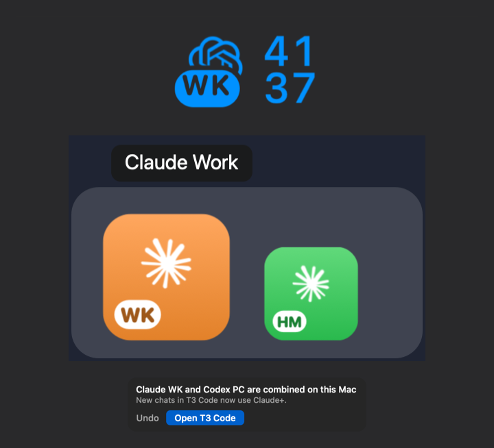

# Prepare Relaybar for Hard Eng UI Single Source of Truth

Status: Complete

## Outcome + scope

Prepare Relaybar for Hard Eng's upcoming UI Single Source of Truth (`b5`) release without modifying `hard-eng.gates.json`, and fix the success screens that the change touches:
1. Move the raw `NSColor.white` and `NSColor.black` literals in `DesktopApp.swift` and `Render.swift` into a dedicated theme owner `Sources/Relaybar/Theme.swift`. The third literal, the white badge behind the tick in `PoolDialogs.swift`, goes away with the blocking success alert that drew it.
1a. Replace the two blocking success alerts (accounts combined, helper moved) with a confirmation note under the menu bar icon: the title that names the combined accounts by kind and tag ("Claude WK and Codex PC are combined on this Mac") with no tick, one detail line, a plain-text Undo button on the left and a filled Open T3 Code button on the right, both aligned to the text edge. It closes by itself after 10 seconds. An offer to set up Tailscale keeps the note open until the user answers. A warning that follows combining or moving shows in its own alert. Owners: `Sources/RelaybarCore/PoolConfirmation.swift` (decisions and text), `Sources/Relaybar/Toast.swift` (drawing), `Sources/Relaybar/PoolFlows.swift` and `Sources/Relaybar/PoolMoveFlow.swift` (use).
1b. Draw the tag text of the desktop icon pill in the account colour mixed 45% with black, so it reads at 3:1 contrast or better on the white pill (`DesktopApp.icon`); the look review found the old colour below 3:1. With a tag, draw the logo higher and smaller (`DesktopIconLayout`) so no logo spoke touches the pill.
2. Add valid, non-mismatched YAML front matter to `DESIGN.md` and document `Theme` and `[UI-LIBRARY.md](UI-LIBRARY.md)` there while keeping all existing prose intact.
3. Generate `UI-LIBRARY.md` for `TARGET_UI_LIBRARY = ["Sources/Relaybar/AccountCard.swift"]`.

Non-goals: adding `"ui_library"` to `hard-eng.gates.json` (the currently installed Hard Eng `0df6e524` rejects unknown shipping keys; `"ui_library"` is added in the post-`b5` Hard Eng update PR) and any change to the menu bar strip. The combine and move flows keep their steps; only how they report success changes.

## Sources + coverage

Sources: N/A — the maintainer task brief and live `b5` scan findings are the only source.

## Repository context

Owners: `Sources/Relaybar/Theme.swift` (new shared colour token owner), `Sources/Relaybar/DesktopApp.swift`, `Sources/Relaybar/PoolDialogs.swift`, `Sources/Relaybar/Render.swift`, `Sources/Relaybar/Toast.swift`, `Sources/RelaybarCore/PoolConfirmation.swift`, `Sources/Relaybar/AccountCard.swift` (shared UI library entry), `DESIGN.md`, `UI-LIBRARY.md`.
Same cause: Checked all Swift files under `Sources/Relaybar/` against the `b5` `ui_whole.ui_findings_whole` scanner; only the three flagged lines (`DesktopApp.swift:113`, `PoolDialogs.swift:384`, `Render.swift:100`) matched `SWIFT_RAW`. The `PoolDialogs.swift` line drew the badge of a success alert that `DESIGN.md` says should be a note, so the alert and its badge are removed.
Single source: `Sources/Relaybar/Theme.swift` is the single owner for shared literal colour tokens (`iconPillFill`, `tagCutoutMask`); `DESIGN.md` is the design doc linking `Theme.swift` and `UI-LIBRARY.md`; `UI-LIBRARY.md` is the generated index for `Sources/Relaybar/AccountCard.swift`.

## Decisions + authorization

Blockers: None.
Authority: Maintainer authorization on 2026-11-22 to fix `sgaabdu4/relaybar` for Hard Eng `b5` UI Single Source of Truth and open a clean merge-ready PR to `main` (without modifying `hard-eng.gates.json` in this PR).
Review declined: Keeping a Tailscale offer on screen over later notes :: each way tried (drop the later note, or bring the offer back after it) left a stale offer or a lost confirmation in some order of events; the plain rule is that a later note replaces the offer, and "Use it away from home…" stays in the menu while Tailscale is needed, so the offer is never the only way to start the setup.
Review declined: Mockup link paths from the plan folder :: Hard Eng's controls check (`.hooks/plan_controls.py`) resolves each mockup path from the repository root and refuses any other form, so the links are written from the root; the same pictures are in the PR as labeled attachments.
Review declined: Keyboard focus for the note buttons :: the note is a non-activating panel on purpose; a key window would send the user's typing in another app to the note, and a stray Return would press "Open T3 Code". Every action has a keyboard path: Undo is "Stop combining…" in the All accounts menu, the Tailscale offer is "Use it away from home…" in the menu, and T3 Code opens from Spotlight.
Review declined: Full interactive Combine accounts GUI journey for `E2E` :: the journey needs live accounts and a reachable home computer, which no check here has; the decisions of the new confirmation (which buttons, when it closes, that Undo exists only for combining) are proven in `Tests/RelaybarCoreTests/PoolConfirmationTests.swift`, and the drawn note is rendered and inspected in `ux_reference` (noted under `Not checked:` in the PR).

## Acceptance + steps

- [x] Move raw `NSColor.white` / `NSColor.black` at `DesktopApp.swift:113` and `Render.swift:100` into `Sources/Relaybar/Theme.swift`, and remove the badge literal at `PoolDialogs.swift:384` with its blocking alert → N/A — verified by `b5` `ui_whole.ui_findings_whole` returning 0 hits and equal Before and After renders of `Render.row` and `DesktopApp.icon`.
- [x] Show combining and moving as a non-blocking confirmation with Undo for combining and one primary action → `Tests/RelaybarCoreTests/PoolConfirmationTests.swift::combiningOffersT3CodeAndUndoThenClosesByItself`, `Tests/RelaybarCoreTests/PoolConfirmationTests.swift::movingTheHelperHasNoUndoAndAnOfferStaysOpen` `Tests/RelaybarCoreTests/PoolConfirmationTests.swift::whenT3CodeKeepsItsOwnDefaultTheNoteTellsTheUserToPickClaudePlus` and the rendered note in `ux_reference`.
- [x] Name in the confirmation only the accounts that are in the helper and on → `Tests/RelaybarCoreTests/PoolAccountsTests.swift::onlyAccountsInTheHelperAndOnCountAsCombined`.
- [x] Add valid YAML front matter and `[UI-LIBRARY.md](UI-LIBRARY.md)` link to `DESIGN.md` keeping existing prose intact → N/A — verified by `b5` `ui_tokens.token_findings` returning 0 hits and `hard-eng.py check` confirming `UI-LIBRARY.md` has a reader.
- [x] Generate `UI-LIBRARY.md` for `["Sources/Relaybar/AccountCard.swift"]` without editing `hard-eng.gates.json` → N/A — verified by `b5` `ui_whole.ui_findings_whole` returning 0 hits and `git diff` confirming `hard-eng.gates.json` is untouched.
- [x] Pass all project gates (`python3 .hooks/hard-eng.py check --base origin/main`) → N/A — verified by the local check run recorded under Verification; independent review (`hard-eng.py challenge`) runs on the committed revision after the check.

## Baseline + execution

Result: Passed
Evidence: Live `b5` UI SSOT scan reported 6 findings (missing `ui_library`, missing `UI-LIBRARY.md`, missing `DESIGN.md` front matter, and 3 raw `NSColor` literals). Baseline `origin/main` rendered `features/ui-single-source/ui-before.png` cleanly.
Execution: Single builder session: extract the three colour literals into `Theme.swift`, update `DESIGN.md`, generate `UI-LIBRARY.md`, render Before (`origin/main`) and After (branch) AppKit previews, verify 0 `b5` findings, commit, full `hard-eng.py check` and `challenge`, then push and open PR.

## Risks + recovery

Adding `"ui_library"` to `hard-eng.gates.json` early would break `0df6e524` CI → intentionally excluded from this PR. Token colour typo could shift icon pill or tag cutout colours → verified byte-identical renders before and after for `Render.row` and `DesktopApp.icon`. Undo runs the same `performStop` as the menu item "Stop combining…", without its two questions, so it follows REQ-POOL-RECOVERY: the stop path saves and clears the state file as it does today. It needs `isFree` and no open sign-in, so it cannot start while another flow runs, and it is offered for 10 seconds after combining only. A Tailscale offer stays open until answered or until a later note replaces it; the menu keeps "Use it away from home…" as the permanent way to start that setup, and "Not Now" brings back the note with Open T3 Code and Undo. Undo is refused while a sign-in is open or opening. Recovery: revert the PR commits on `main`.

## ux_reference

Result: Passed
Evidence: Compiled the changed Swift files from `origin/main` (Before) and this branch (After) with the bundled Claude and Codex logos and the real Relaybar icon. Rendered `Render.row`, `DesktopApp.icon`, the old blocking alert from `PoolDialogs.done` and the new confirmation note. The strip is equal in its pair. The icon differs in the darker tag text and the higher logo. The success screen differs: Before an alert with two stacked equal buttons, After the note with Undo and a filled Open T3 Code. Stacked image SHA-256 `5f034089c891` (After).
Surface: Existing — macOS menu bar strip, desktop icon pill and the combined-accounts success screen, no browser serves them; owners `Sources/Relaybar/Render.swift`, `Sources/Relaybar/DesktopApp.swift`, `Sources/Relaybar/Toast.swift`, `Sources/Relaybar/PoolFlows.swift` and `Sources/Relaybar/Theme.swift`
Before: 
Proposed: 
Controls: Open T3 Code button — new `Sources/Relaybar/Toast.swift` — mockup ; Undo button — new `Sources/Relaybar/Toast.swift` — mockup ; Set Up Tailscale and Not Now buttons — new `Sources/Relaybar/Toast.swift` — mockup 
Capture: Direct AppKit render, not a browser capture. One program drew the strip, the icon and the window at 2x from each checkout (merge base and head); the strip shows one tagged account with sample numbers, and the icons are drawn in a row on a Dock-like shelf with no name label under them, because the Dock and the app switcher show a name only under the pointer; the pointer is over the first icon, so it is magnified and the Dock shows its name in a bubble above, as the Dock does, while the other icon shows no name; the two icons share the Claude logo, so the tag and the colour are what tell them apart. The stacked image holds the strip, the icon and the success screen. `offer.png` shows the note when Tailscale is offered (After only; Before had no such note). The PR carries one labeled pair for each surface.
Review: Inspected the three pairs and `offer.png`. The strip does not change. The icon tag text is darker and the logo clears the pill. The success screen no longer blocks the user, offers Undo, has one filled primary action and lines up its buttons with the text. Develop's `look --plan` was clean in two runs at the final head. The installed `look` is not clean: it passed and failed one element at one head with the same image hashes, so it cannot judge this PR and the PR waits for the new `look` (see Delivery).
Rules:

- Mistake-proof: Pass — the title names each combined account by kind and tag ("Claude WK"), Undo reverses combining in one tap and the note is not modal.
- Least effort: Pass — 0 clicks to dismiss, because the note closes by itself, and 1 click for Open T3 Code or Undo.
- Observe: Pass — the title says the result and the detail says what happens next.
- Undo: Pass — Undo is on the note for 10 seconds after combining; moving the helper has none because moving back is its own flow.
- No clutter: Pass — 3 kept, 0 removed (menu bar strip, desktop icon, confirmation note).
- Hierarchy: Pass — one filled accent button (Open T3 Code) and an Undo that is plain text with no fill.
- Alignment: Pass — the buttons start at the text edge, under the title and the detail.
- Spacing: Pass — 8 pt between the text and the buttons and 9 pt padding around the note; on the icon the logo sits above the tag pill with a gap.
- Design system: Pass — `DESIGN.md` says to confirm with a note and keep alerts for failures; the note uses the system accent colour and the shared `Toast`.
- Messages: Pass — plain text, one result sentence and one next-step sentence.
- States: Pass — the offer state stays open with Set Up Tailscale and Not Now; the warning state shows its own alert.
- Time: N/A — the 10 second close is the only timing and no clock or time zone is shown.
- Audit: N/A — a single-user local menu bar app has no staff or admin roles.
- Accessibility: Pass — the icon tag text is now the account colour mixed 45% with black on white, and the note text uses system label colours; the white text on the Open T3 Code button reads at 4.5:1 or better because the fill is the accent colour mixed 25% with black.
- Widths: N/A — the note has a fixed native width of about 350 pt and no responsive layout.
- Performance: Pass — `scripts/efficiency.sh` stays at the 15 MB footprint and 0.01 s idle CPU.

## Verification

Result: Passed
Evidence: `Tests/RelaybarCoreTests/PoolConfirmationTests.swift` and `DesktopIconLayoutTests.swift` ran red before the code and green after; `b5` `ui_whole.ui_findings_whole` returned 0 findings for `TARGET_UI_LIBRARY = ["Sources/Relaybar/AccountCard.swift"]`. At `8e1db2c`: `python3 .hooks/hard-eng.py check --plan-stage Complete --base origin/main` exited 0 with lockfile, format, tests, build, efficiency (15 MB footprint, 0.01 s idle CPU), secrets-files, secrets-history, vulnerabilities, zizmor, actionlint, shellcheck and security all passing; the same command with Hard Eng develop's `.hooks` and `.agents` in a scratch copy found `HE-UI-SOURCE` at `Sources/Relaybar/Toast.swift:165` (a typed white), which `5c1d061` fixes by moving the button colours into `Theme`. Develop's `look --plan` was clean at `ca10225`, `2c73181`, `15684f5` and `8e1db2c`. The installed `look` gave a pass and a fail on the same element at one head with the same image hashes, so the PR holds (see Delivery). The runs at the final head, including two develop `look` runs, are in the PR text.
E2E: N/A — interactive Combine accounts GUI journey waived per declined review decision above (the decisions are tested in `PoolConfirmationTests`; the Undo button calls the same `performStop` as Stop combining; startup and resource budgets are verified by `scripts/efficiency.sh`).
Real service: N/A — no outside service calls are made or changed by this token refactor.
Retro: None — clean refactor with no recurring failures or new process gaps.
Delivery target: Merge
Delivery: Pending — on hold. This PR waits for the Hard Eng release that carries the new `look` (it reads DESIGN.md), then for Relaybar's Hard Eng update PR. The installed `look` gave different answers for the same images at the same head, so `ship` and the merge wait for the new `look`. CI on the PR must pass first.
