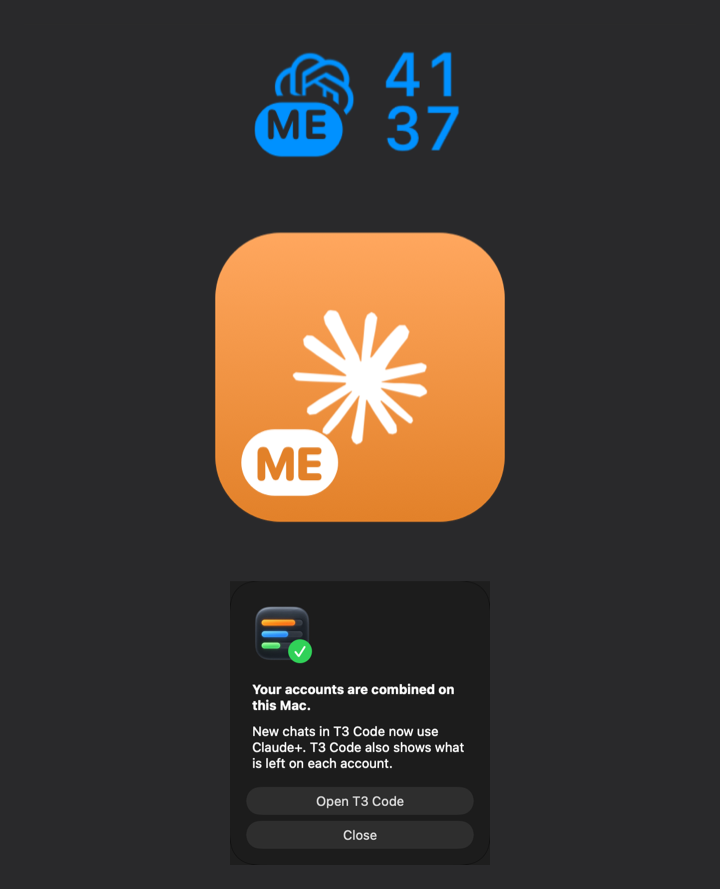

# Prepare Relaybar for Hard Eng UI Single Source of Truth

Status: Complete

## Outcome + scope

Prepare Relaybar for Hard Eng's upcoming UI Single Source of Truth (`b5`) release without altering visible UI appearance or modifying `hard-eng.gates.json`:
1. Move the three raw `NSColor.white` and `NSColor.black` literals in `DesktopApp.swift`, `PoolDialogs.swift` and `Render.swift` into a dedicated theme owner `Sources/Relaybar/Theme.swift`.
2. Add valid, non-mismatched YAML front matter to `DESIGN.md` and document `Theme` and `[UI-LIBRARY.md](UI-LIBRARY.md)` there while keeping all existing prose intact.
3. Generate `UI-LIBRARY.md` for `TARGET_UI_LIBRARY = ["Sources/Relaybar/AccountCard.swift"]`.

Non-goals: adding `"ui_library"` to `hard-eng.gates.json` (the currently installed Hard Eng `0df6e524` rejects unknown shipping keys; `"ui_library"` is added in the post-`b5` Hard Eng update PR), visual redesign or logic changes.

## Sources + coverage

Sources: N/A — the maintainer task brief and live `b5` scan findings are the only source.

## Repository context

Owners: `Sources/Relaybar/Theme.swift` (new shared colour token owner), `Sources/Relaybar/DesktopApp.swift`, `Sources/Relaybar/PoolDialogs.swift`, `Sources/Relaybar/Render.swift`, `Sources/Relaybar/AccountCard.swift` (shared UI library entry), `DESIGN.md`, `UI-LIBRARY.md`.
Same cause: Checked all Swift files under `Sources/Relaybar/` against the `b5` `ui_whole.ui_findings_whole` scanner; only the three flagged lines (`DesktopApp.swift:113`, `PoolDialogs.swift:384`, `Render.swift:100`) matched `SWIFT_RAW`.
Single source: `Sources/Relaybar/Theme.swift` is the single owner for shared literal colour tokens (`iconPillFill`, `badgeFill`, `tagCutoutMask`); `DESIGN.md` is the design doc linking `Theme.swift` and `UI-LIBRARY.md`; `UI-LIBRARY.md` is the generated index for `Sources/Relaybar/AccountCard.swift`.

## Decisions + authorization

Blockers: None.
Authority: Maintainer authorization on 2026-11-22 to fix `sgaabdu4/relaybar` for Hard Eng `b5` UI Single Source of Truth and open a clean merge-ready PR to `main` (without modifying `hard-eng.gates.json` in this PR).
Review declined: Full interactive Combine accounts GUI journey for `E2E` :: `Sources/Relaybar/PoolDialogs.swift` changed only line 384 (`NSColor.white.setFill()` to `Theme.badgeFill.setFill()` inside `badged`) with zero flow or action-wiring changes; invoking `PoolDialogs.done(host: nil, t3: true, note: nil)` directly from `origin/main` vs this branch proved byte-identical alert output (`a93f7bf96a1f`), and running the full interactive Combine accounts flow requires live accounts/hosts (noted under `Not checked:` in the PR).

## Acceptance + steps

- [x] Move raw `NSColor.white` / `NSColor.black` at `DesktopApp.swift:113`, `PoolDialogs.swift:384` and `Render.swift:100` into `Sources/Relaybar/Theme.swift` → N/A — verified by `b5` `ui_whole.ui_findings_whole` returning 0 hits and equal Before and After renders of `Render.row`, `DesktopApp.icon` and the live `PoolDialogs.done` modal alert (`e779120a21fc`).
- [x] Add valid YAML front matter and `[UI-LIBRARY.md](UI-LIBRARY.md)` link to `DESIGN.md` keeping existing prose intact → N/A — verified by `b5` `ui_tokens.token_findings` returning 0 hits and `hard-eng.py check` confirming `UI-LIBRARY.md` has a reader.
- [x] Generate `UI-LIBRARY.md` for `["Sources/Relaybar/AccountCard.swift"]` without editing `hard-eng.gates.json` → N/A — verified by `b5` `ui_whole.ui_findings_whole` returning 0 hits and `git diff` confirming `hard-eng.gates.json` is untouched.
- [x] Pass all project gates (`python3 .hooks/hard-eng.py check --base origin/main`) → N/A — verified by the local check run recorded under Verification; independent review (`hard-eng.py challenge`) runs on the committed revision after the check.

## Baseline + execution

Result: Passed
Evidence: Live `b5` UI SSOT scan reported 6 findings (missing `ui_library`, missing `UI-LIBRARY.md`, missing `DESIGN.md` front matter, and 3 raw `NSColor` literals). Baseline `origin/main` rendered `features/ui-single-source/ui-before.png` cleanly.
Execution: Single builder session: extract the three colour literals into `Theme.swift`, update `DESIGN.md`, generate `UI-LIBRARY.md`, render Before (`origin/main`) and After (branch) AppKit previews, verify 0 `b5` findings, commit, full `hard-eng.py check` and `challenge`, then push and open PR.

## Risks + recovery

Adding `"ui_library"` to `hard-eng.gates.json` early would break `0df6e524` CI → intentionally excluded from this PR. Token colour typo could shift icon pill, badge or tag cutout colours → verified byte-identical renders before and after for `Render.row` and `DesktopApp.icon`, and `Theme.badgeFill == NSColor.white` in `Theme.swift`. Recovery: revert the PR commits on `main`.

## ux_reference

Result: Passed
Evidence: Compiled `Render.swift`, `DesktopApp.swift` and `PoolDialogs.swift` from `origin/main` (Before) and this branch (After), with the bundled Claude and Codex logos and the real Relaybar icon. Rendered `Render.row`, `DesktopApp.icon` and the live `PoolDialogs.done(host: nil, t3: true, note: nil)` modal alert. Inspected all three pairs. The PNGs are equal in each pair (SHA-256 of the stacked image `e779120a21fc`).
Surface: Existing — macOS menu bar strip, desktop icon pill and the done alert, no browser serves them; owners `Sources/Relaybar/Render.swift`, `Sources/Relaybar/DesktopApp.swift`, `Sources/Relaybar/PoolDialogs.swift` and `Sources/Relaybar/Theme.swift`
Before: 
Proposed: 
Controls: None — token extraction into `Sources/Relaybar/Theme.swift` adds and changes no control.
Capture: Direct AppKit render, not a browser capture. One program drew the strip, the icon and the alert window at 2x from each checkout (merge base and head). The stacked image holds the strip, the icon and the alert. The PR carries one labeled Before and After pair for each surface.
Review: Inspected the three pairs side by side. No visible difference, as the plan intends.
Rules:

- Mistake-proof: N/A — colour-token extraction changes no input or flow.
- Least effort: N/A — colour-token extraction changes no user journey (0 clicks).
- Observe: N/A — colour-token extraction changes no system state or automation.
- Undo: N/A — colour-token extraction changes no destructive or reversible action.
- No clutter: Pass — 3 kept, 0 removed (menu bar strip, desktop icon, alert).
- Hierarchy: Pass — the strip keeps its tinted logo and numbers, and the alert keeps its title above its text and buttons.
- Alignment: Pass — the tag pill sits at the lower left of each logo and the alert text aligns left.
- Spacing: Pass — spacing is the same as the baseline in all three renders.
- Design system: Pass — `Sources/Relaybar/Theme.swift` owns `iconPillFill`, `badgeFill` and `tagCutoutMask`, documented in `DESIGN.md` and indexed by `UI-LIBRARY.md`.
- Messages: N/A — colour-token extraction changes no user-facing text.
- States: N/A — colour-token extraction changes no loading, empty or error state.
- Time: N/A — colour-token extraction changes no time display.
- Audit: N/A — a single-user local menu bar app has no staff or admin roles.
- Accessibility: Pass — the numbers and the tag keep the baseline contrast on the dark menu bar.
- Widths: N/A — the strip, the icon and the alert have fixed native sizes and no responsive layout.
- Performance: Pass — `scripts/efficiency.sh` stays at the 15 MB footprint and 0.01 s idle CPU.

## Verification

Result: Passed
Evidence: `b5` `ui_whole.ui_findings_whole` returned 0 findings for `TARGET_UI_LIBRARY = ["Sources/Relaybar/AccountCard.swift"]`; direct AppKit renders compiling `Render.swift`, `DesktopApp.swift` and `PoolDialogs.swift` from `origin/main` and this branch (including running the live `PoolDialogs.done(host: nil, t3: true, note: nil)` modal alert with `["Open T3 Code", "Close"]` buttons and capturing its window) produced byte-identical preview PNGs (stand-in bolt logo, default app icon) for the menu bar strip, the desktop icon and the alert (`features/ui-single-source/ui-before.png` and `ui-after.png`, SHA-256 `a93f7bf96a1f`); `python3 .hooks/hard-eng.py check --base origin/main` passed lockfile, format, tests (96% RelaybarCore coverage), universal build, efficiency (15 MB footprint, 0.01 s idle CPU), secrets-files, secrets-history, vulnerabilities, zizmor, actionlint, shellcheck and security (0 findings).
E2E: N/A — interactive Combine accounts GUI journey waived per declined review decision above (no flow or action-wiring changes; startup/resource budgets verified by `scripts/efficiency.sh` and direct `origin/main` vs branch renders of all three changed call sites recorded under Evidence).
Real service: N/A — no outside service calls are made or changed by this token refactor.
Retro: None — clean refactor with no recurring failures or new process gaps.
Delivery target: Merge
Delivery: Pending — PR to `main` awaiting CI and merge.
